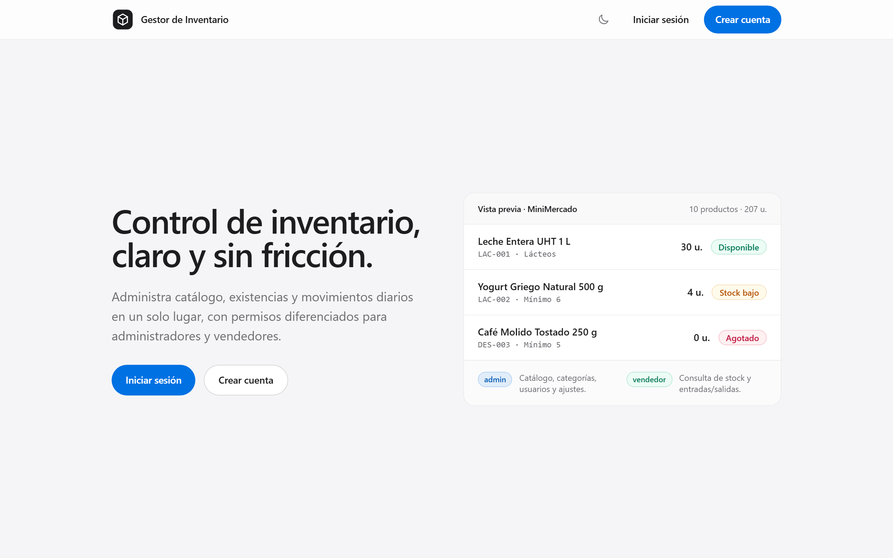
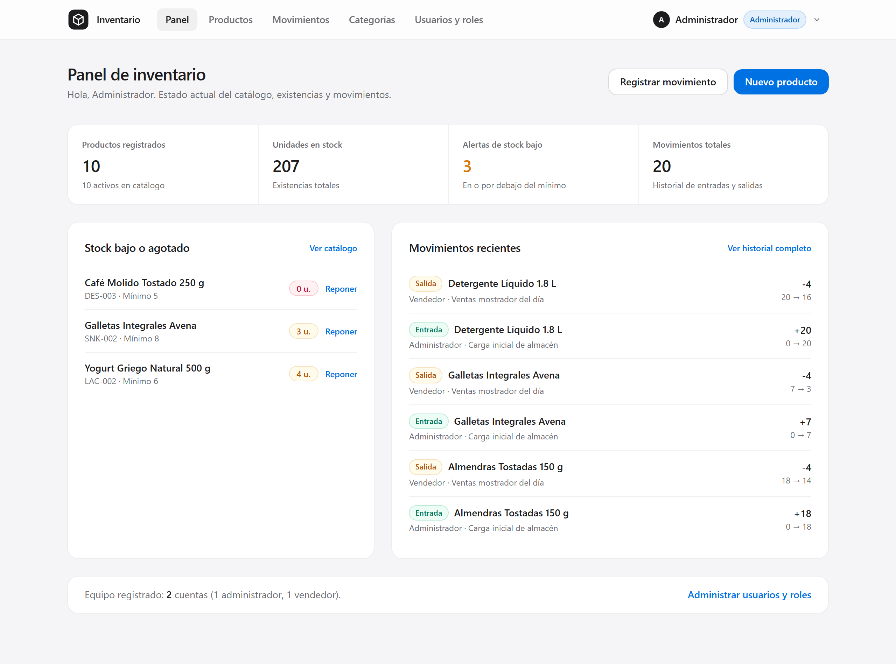
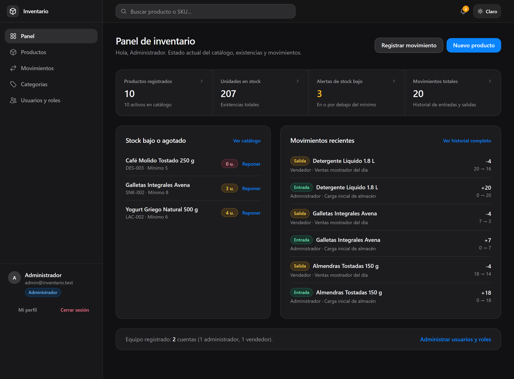
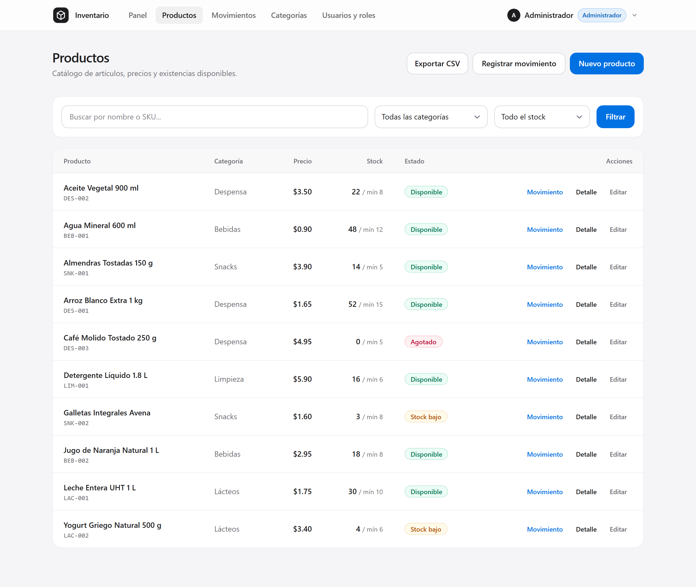
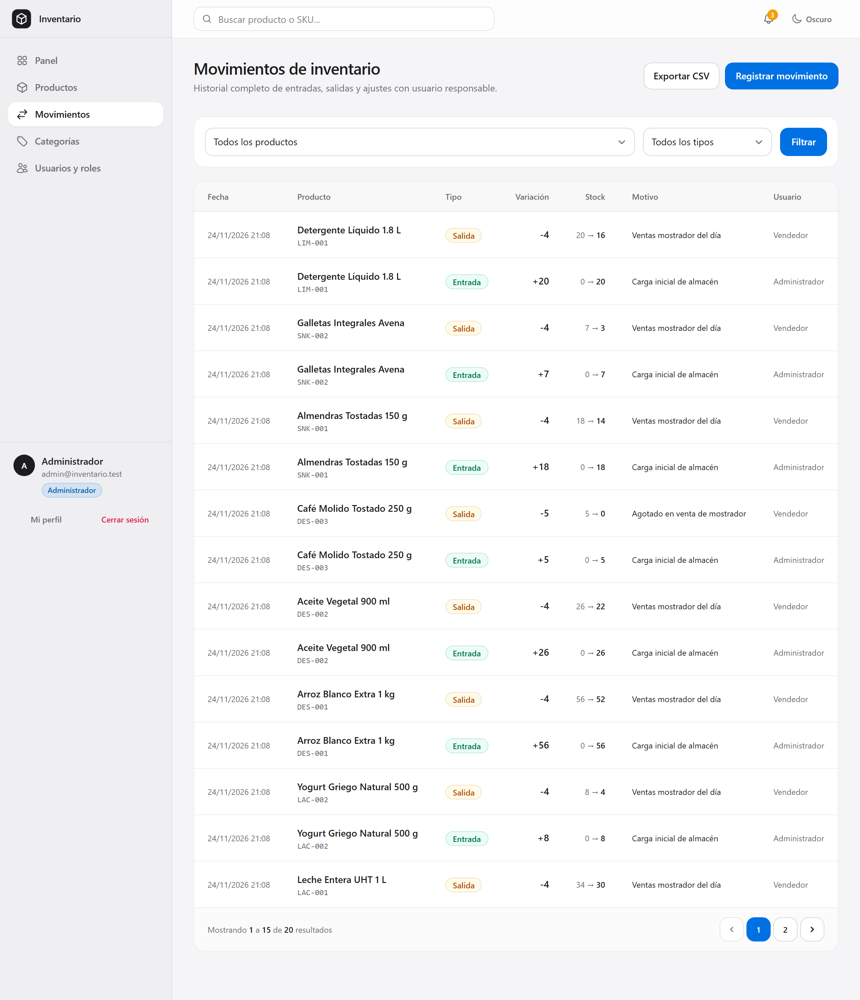

# Gestor de Inventario con Laravel

Versión pública y construida desde cero de un sistema de gestión de inventario tipo MiniMercado: autenticación, roles (`admin` y `vendedor`), categorías, productos, control de stock, kardex de movimientos, exportación CSV y una interfaz limpia y fluida inspirada en el lenguaje visual de Apple, con soporte para modo claro y oscuro.

## Características principales

- **Autenticación y roles (`admin` y `vendedor`)**: Registro, inicio de sesión, verificación de acceso por middleware y `Gate`s (`manage-users`, `manage-products`, `manage-inventory`, `view-inventory`).
- **Sidebar lateral y barra de utilidades**: Navegación lateral filtrada por rol (con drawer táctil en móvil), buscador global por nombre o SKU en la parte superior y campana de alertas de stock bajo con acceso directo a reposición.
- **Modo claro y oscuro**: Selector persistente en `localStorage` con detección inicial automática de preferencia del sistema sin parpadeo al cargar.
- **CRUD de categorías y productos**: Búsqueda por nombre o SKU, filtro por categoría y estado de stock (`Disponible`, `Stock bajo`, `Agotado`), cálculo de margen y ficha de detalle por producto.
- **Control de stock y kardex transaccional**: Registro de **Entradas**, **Salidas** y **Ajustes** dentro de transacciones SQL (`lockForUpdate`) con historial completo de stock anterior, nuevo stock, motivo y usuario responsable.
- **Exportación a CSV**: Descarga en streaming del catálogo filtrado y del historial de movimientos (delimitador `;` y UTF-8 con BOM para abrir columnas limpias en Excel en español, más saneamiento contra inyección de fórmulas).
- **Panel operativo**: Métricas clicables hacia cada vista filtrada, alertas de stock bajo/agotado y movimientos recientes.

## Capturas de pantalla

### Inicio y control de acceso


### Panel de inventario (modo claro y modo oscuro)




### Catálogo de productos y exportación CSV


### Kardex de movimientos


## Roles del sistema

| Rol | Clave | Alcance |
| --- | --- | --- |
| Administrador | `admin` | Gestión de usuarios y roles, categorías, catálogo completo de productos (crear, editar, eliminar), stock, movimientos y exportación CSV. |
| Vendedor | `vendedor` | Consulta de panel, catálogo/detalle de productos, stock, registro de movimientos de inventario y exportación CSV (rol por defecto al registrarse). |

## Stack tecnológico

- **Backend**: PHP 8.3 · Laravel 13 · SQLite / MySQL
- **Frontend**: Laravel Breeze (Blade + Alpine.js) · Tailwind CSS · Vite
- **Calidad**: PHPUnit (Feature tests) · Laravel Pint

## Instalación local

```bash
composer install
cp .env.example .env
php artisan key:generate
touch database/database.sqlite
php artisan migrate --seed
npm install
npm run build
php artisan serve
```

### Usuarios de ejemplo (solo desarrollo)

El seeder `DatabaseSeeder` crea dos cuentas verificadas con contraseña `password` junto con 5 categorías, 10 productos y 20 movimientos de ejemplo:

- **Administrador**: `admin@inventario.test`
- **Vendedor**: `vendedor@inventario.test`

> **Nota de seguridad**: En producción establece `APP_DEBUG=false`, `APP_ENV=production`, apunta el DocumentRoot del servidor web únicamente a `public/` y cambia o elimina las cuentas de ejemplo.

## Pruebas

```bash
php artisan test
```
